# 🍪 Biscuit

A chat app for you and your friends: servers, channels, DMs, GIFs, emoji, screenshots and fully customizable profiles.
Everything other chat apps charge for is free here. We call it the **Golden Biscuit**, and every account has it.

## ▶️ [Open Biscuit](https://froodyofficial-maker.github.io/Biscuit-/)

## Put Biscuit online so friends can find you (free, about 5 minutes)

GitHub Pages can only show files, so on its own every browser gets a separate copy of Biscuit.
To share accounts, servers and messages, Biscuit runs its server on **Cloudflare's free plan**. You set this up once:

1. **Make a free Cloudflare account** at <https://dash.cloudflare.com/sign-up> and confirm your email. No card needed.
2. In the Cloudflare dashboard, open **Workers & Pages** once. If it asks you to choose a `workers.dev` subdomain, pick any name.
3. **Create an API token:** click your profile icon (top right) → **Profile** → **API Tokens** → **Create Token** →
   next to **Edit Cloudflare Workers**, click **Use template** → under *Account Resources* pick your account,
   under *Zone Resources* pick **All zones** → **Continue to summary** → **Create Token**. Copy the token.
4. **Give it to GitHub:** in this repository go to **Settings → Secrets and variables → Actions → New repository secret**.
   Name it `CLOUDFLARE_API_TOKEN`, paste the token, and save.
5. Go to the **Actions** tab → **Deploy to Cloudflare** → **Run workflow**.

When it finishes, the run's summary shows your live address (`https://biscuit.<your-name>.workers.dev`), and the
GitHub Pages link above sends everyone there automatically. From then on every push to `main` updates the live site.

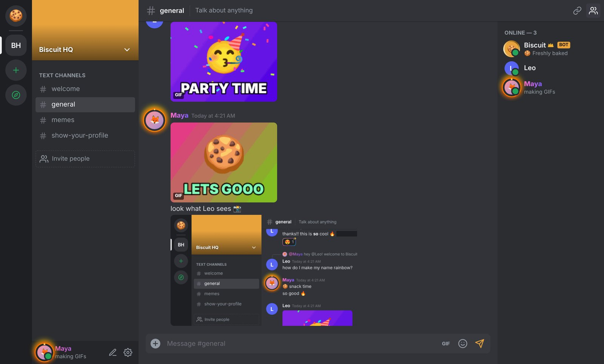

## Run it yourself

You need [Node.js](https://nodejs.org) 18 or newer. There is nothing to install: Biscuit has no dependencies.

```bash
npm start
```

Then open <http://localhost:3000>. Friends on your network can join at `http://<your-computer's-ip>:3000`.

**No server?** Open `public/index.html` straight from disk, or host the `public/` folder on any static host such as GitHub Pages.
Biscuit then runs in **browser mode**: accounts and chats are saved in that browser only. Everything else works the same.
The [website](https://froodyofficial-maker.github.io/Biscuit-/) is served by GitHub Pages from the `main` branch: the root `index.html` opens the app in `public/`.

| Setting | What it does |
| --- | --- |
| `PORT=8080` | Port to listen on (default `3000`). |
| `DATA_DIR=./data` | Where accounts, messages (`db.json`) and uploads are kept. |
| `GIPHY_API_KEY=…` or `TENOR_API_KEY=…` | Optional. Turns on GIF search for everyone on the server. |

On Cloudflare, uploads are limited to 25 MB each, and all data lives in one Durable Object's SQLite storage
(`worker/index.js`, configured in `wrangler.toml`). To turn on GIF search there, run `npx wrangler secret put GIPHY_API_KEY`.

## Features

### Accounts
- Pick **any username and any password**: spaces, capitals, symbols and emoji all work. Usernames are unique, ignoring upper/lower case.

### Chat
- **Anyone can create servers**: start from scratch or a template (Gaming, Friends, Study Group, School Club, Artists & Creators, Local Community)
- Servers with text channels, invite links and a member list with live online / idle / do-not-disturb / invisible status
- Direct messages with anyone, by username
- Replies, editing (press ↑ to edit your last message), deleting, typing indicators, unread dots and mention badges
- Markdown: `**bold**`, `*italic*`, `__underline__`, `~~strike~~`, `||spoilers||`, `` `code` ``, code blocks, `> quotes`, `# headings`
- `@mentions` with autocomplete, desktop notifications and a sound for DMs and mentions
- **Biscuit the bot** lives in Biscuit HQ and in your DMs: `!help`, `!roll 2d6`, `!poll`, `!8ball`, `!joke` and more

### GIFs
- **Biscuit GIFs**: a pack of animated reaction GIFs generated in your browser. No account, API key or internet needed.
- **GIF Maker**: pick any emoji, a caption, an animation (bounce, spin, rainbow, confetti, glitch…) and colors, and get a real animated GIF
- Upload your own GIFs, paste any GIF link into chat, and ⭐ star GIFs to keep them in **Favorites**
- Optional GIPHY / Tenor search (set a key on the server, or paste a free GIPHY key in **Settings → GIFs**)

| GIF picker | GIF Maker |
| --- | --- |
| 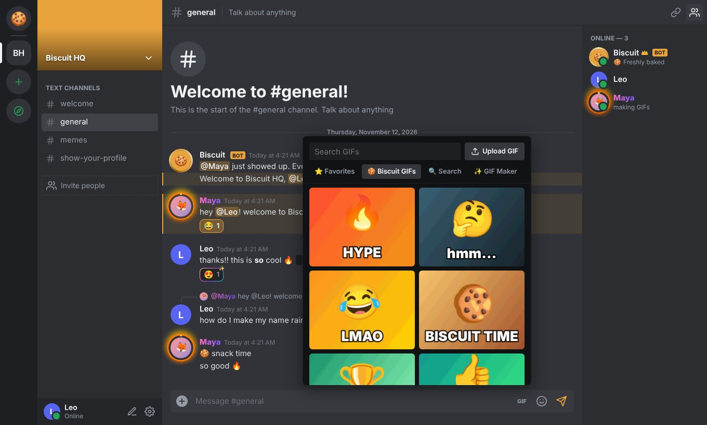 | 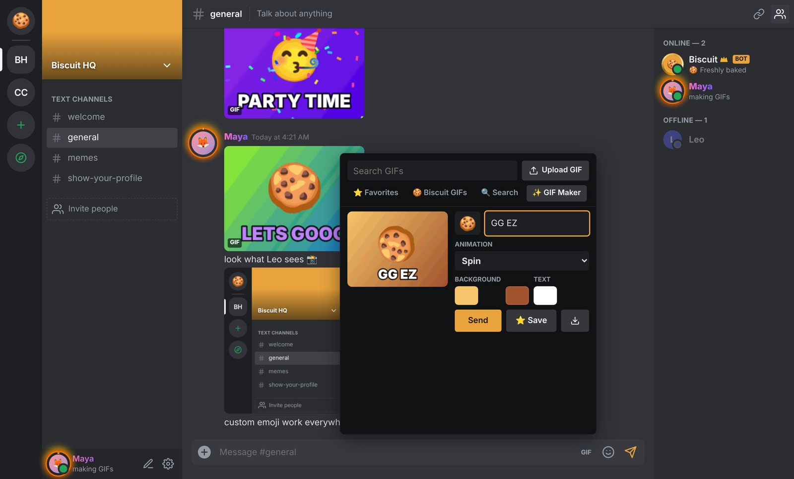 |

### Emoji
- Full emoji picker with search, categories and frequently used
- `:shortcode:` autocomplete as you type (`:fire` → 🔥)
- **Custom server emoji** (PNG or animated GIF) that work in every server and every DM
- Reactions, plus **super reactions** that burst across the screen

| Emoji picker | Super reactions |
| --- | --- |
| 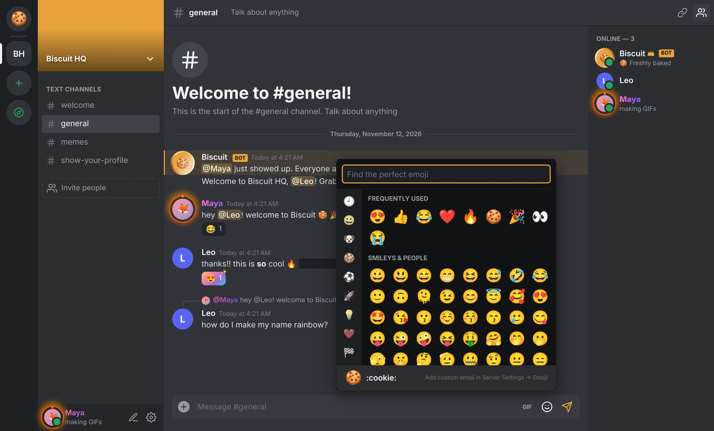 | 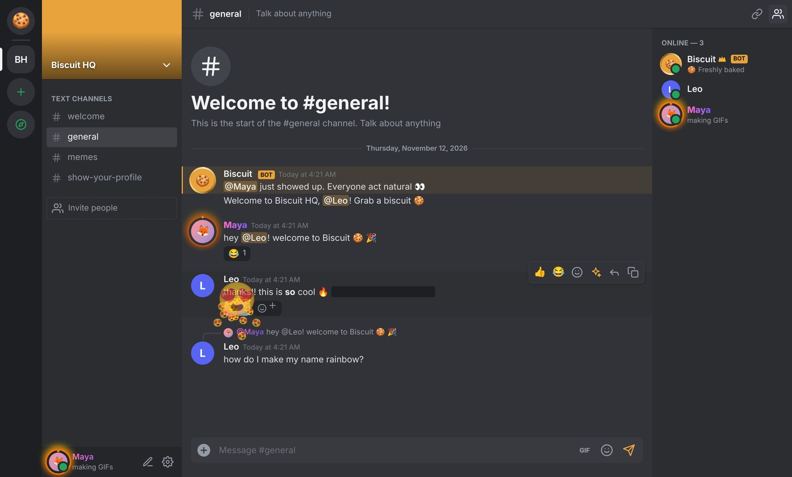 |

### Screenshots and files
- **Paste a screenshot** with Ctrl+V / ⌘V and it's attached
- **Take a screenshot** of your screen or a window straight from the ＋ menu
- Drag and drop files anywhere, up to 10 per message and 100 MB each, with upload progress
- Images, videos and audio play inline. Mark any attachment as a spoiler. Click an image to view it full size.

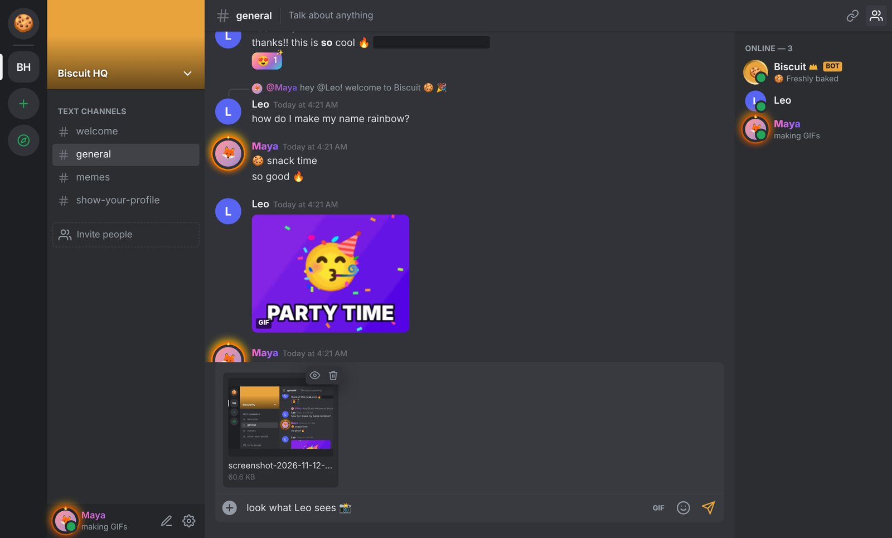

### Profiles
Open **User Settings → Profiles** (the ✏️ next to your name). The preview updates live as you edit.
- Avatar and banner, including **animated GIFs**
- **Avatar decorations**: rainbow, fire, neon, gold, sparkle, crown, hearts, cat ears, halo, glitch
- **Profile effects**: confetti, snow, stars, hearts, bubbles, aurora, embers
- **Profile themes**: paint your whole card with two colors
- **Display name style**: a color or gradient, plus six fonts
- Pronouns, About Me (with markdown), custom status with emoji, and badges

| Profile editor | Profile card |
| --- | --- |
| 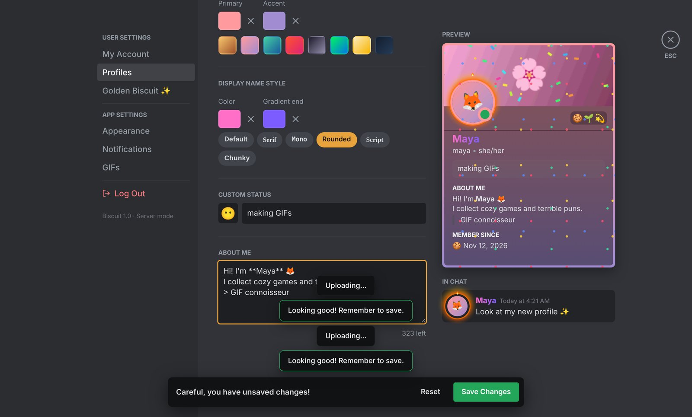 | 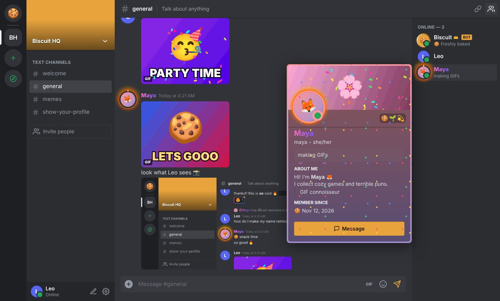 |

### Golden Biscuit: every perk, free
Animated avatars, banners and server icons · profile themes, decorations and effects · styled names · custom emoji everywhere ·
super reactions · 100 MB uploads · 4,000-character messages · gradient app themes · vanity invite links · the GIF Maker.

| Sunset theme | Light theme |
| --- | --- |
| 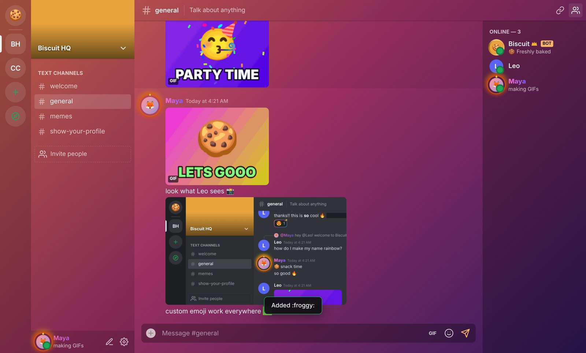 | 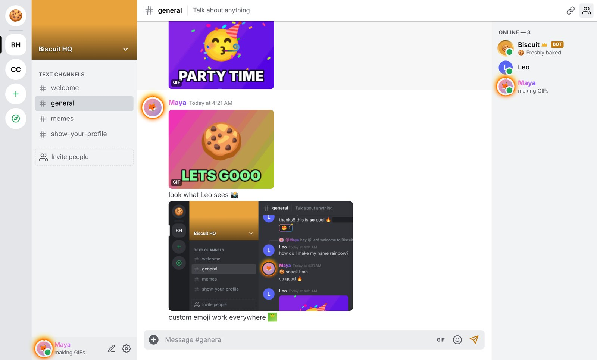 |

Biscuit also works on phones:

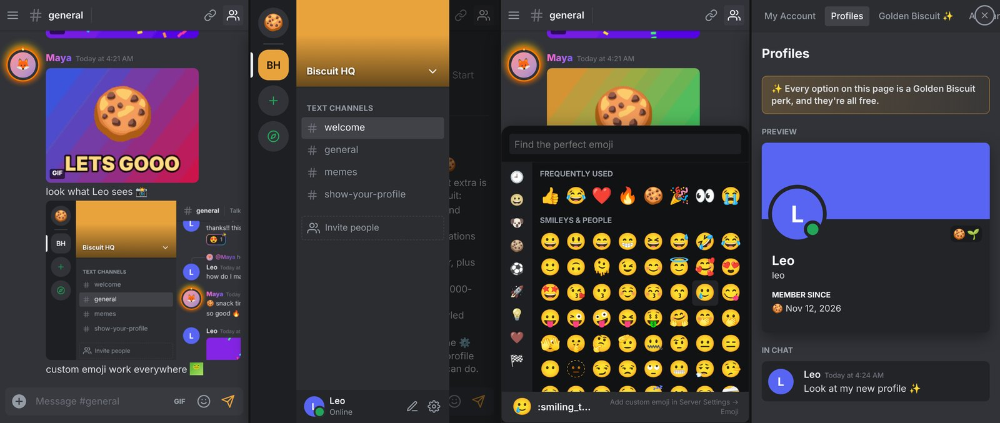

## How it's built

```
server.mjs              Node server: accounts, uploads, live updates (Server-Sent Events), GIF search proxy
worker/index.js         the same server for Cloudflare Workers (Durable Object + SQLite + WebSockets)
wrangler.toml           Cloudflare config; .github/workflows/deploy.yml deploys it
public/index.html       app shell
public/css/app.css      all styling: themes, decorations, profile effects
public/js/core.js       the chat model (users, servers, messages, reactions, emoji, bot). Runs on the server AND in the browser
public/js/api.js        server mode / local mode
public/js/app.js        the UI
public/js/gif.js        animated-GIF encoder, built-in GIFs and the GIF Maker
public/js/emoji-data.js emoji set
public/js/markdown.js   safe chat markdown
tools/check.mjs         syntax check + core smoke test (npm run check)
```

Passwords are hashed with scrypt. Uploaded files that aren't images, video or audio are always served as downloads.
